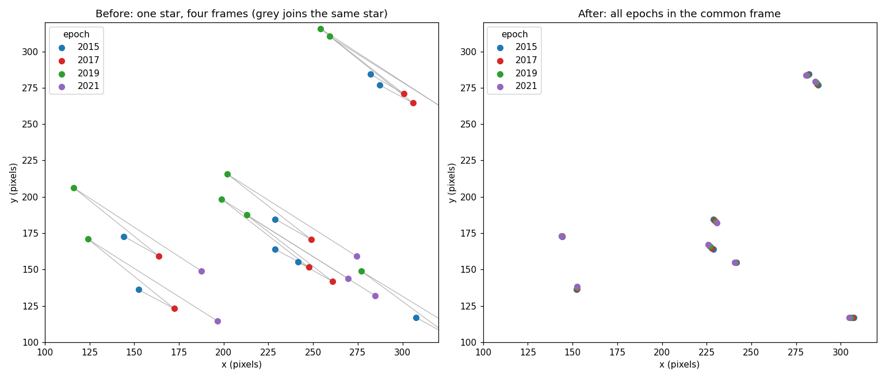
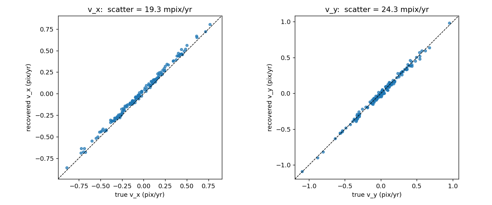

===============
First alignment
===============

Start to finish
---------------

This runs as written -- no data files, no downloads.

First the data, which is the stand-in for whatever produces your own star lists:
250 stars observed at four epochs two years apart, each epoch given its own
coordinate system -- a shift of up to 40 pixels and a small rotation about the
field centre -- with 12% of the stars missing from any one epoch and 0.05
pixels of noise on the rest. That becomes one
:class:`~flystar.starlists.StarList` per epoch, each tagged with when it was
taken:

.. code-block:: python

   import numpy as np
   from flystar import align, starlists, transforms

   rng = np.random.default_rng(42)
   N, YEARS, ERR = 250, np.array([2015.0, 2017.0, 2019.0, 2021.0]), 0.05
   t0 = YEARS.mean()

   # Truth: positions at t0, proper motions in pixels/year, magnitudes.
   x0 = rng.uniform(0, 1000, N); y0 = rng.uniform(0, 1000, N)
   vx = rng.normal(0, 0.3, N);   vy = rng.normal(0, 0.3, N)
   mag = rng.uniform(12, 19, N)
   names = np.array([f'S{j:03d}' for j in range(N)])

   # Each epoch gets its own frame: a shift of up to 40 pixels plus a small
   # rotation about the field centre. That is what the alignment has to undo.
   shift_x = np.array([0., 18., -25., 40.])
   shift_y = np.array([0., -12., 30., -20.])
   angle = np.deg2rad(np.array([0., 0.3, -0.5, 0.7]))

   lists = []
   for i, yr in enumerate(YEARS):
       dt = yr - t0
       xt, yt = x0 + vx * dt, y0 + vy * dt        # where the stars really are
       xc, yc = xt - 500., yt - 500.
       c, s = np.cos(angle[i]), np.sin(angle[i])
       xo = (c * xc - s * yc) + 500. + shift_x[i] + rng.normal(0, ERR, N)
       yo = (s * xc + c * yc) + 500. + shift_y[i] + rng.normal(0, ERR, N)
       seen = rng.random(N) > 0.12                # ~12% non-detections per epoch

       sl = starlists.StarList(
           name=names[seen], x=xo[seen], y=yo[seen], m=mag[seen],
           xe=np.full(seen.sum(), ERR), ye=np.full(seen.sum(), ERR),
           me=np.full(seen.sum(), 0.05),
       )
       sl.meta['list_time'] = yr                  # decimal year, UTC
       lists.append(sl)

The alignment itself is one object and one call. Then the answer is read off
the ``StarTable`` it built -- here checked against the truth that went in,
which is the only part of this a real data set would not have:

.. code-block:: python

   msc = align.MosaicSelfRef(
       lists,
       dr_tol=[60., 10., 5.],           # match radius in pixels, per iteration
       dm_tol=[1., 1., 1.],
       trans_class=transforms.PolyTransform,
       trans_args={'order': 1},         # shift + rotation + scale
       motion_models='Linear',          # fit x0, vx, y0, vy for every star
       init_guess_mode='miracle',       # blind triangle match -- names not needed
   )
   msc.fit()
   ref = msc.ref_table

   good = np.asarray(ref['n_detect']) == len(YEARS)
   i_of = {n: j for j, n in enumerate(names)}
   idx = np.array([i_of.get(n, -1) for n in np.asarray(ref['name']).astype(str)])
   ok = good & (idx >= 0)

   print(f"{len(ref)} stars, {int(good.sum())} seen in all four epochs")
   print(f"vx recovered to {np.std(np.asarray(ref['vx'])[ok] - vx[idx[ok]]) * 1000:.1f} mpix/yr")

.. code-block:: text

   254 stars, 144 seen in all four epochs
   vx recovered to 19.3 mpix/yr

254 rows for the 250 stars injected, and 144 seen in every epoch -- close to the
:math:`250 \times 0.88^4 \approx 150` expected from a 12% per-epoch drop-out.
The few extra rows are stars matched in only one or two epochs.

That every epoch ends up in one frame is the thing to look at. On the left each
star is measured in four visibly different places, one per epoch, with grey
lines joining the four measurements of the same star; on the right, the same
stars after transformation. ``ref_table['x_orig']``/``['y_orig']`` keep the
untransformed positions, so plotting them against ``['x']``/``['y']`` is the
before-and-after directly:

The proper motions are the stronger check. FlyStar was never told what they
were, and the frames were rotating underneath them, so recovering them to 20
milli-pixels per year -- against a 50 milli-pixel per-epoch measurement error
over a six-year baseline -- says the alignment has not absorbed the stars'
motion into the frame solution, which is the failure mode that matters:

:doc:`examples/alignment_example` is this same example at greater length, with
the code for these figures, the residual distribution, and what each argument
above is doing.

With your own data
------------------

Real lists come off disk rather than out of a random number generator, but
nothing else changes -- build one
:class:`~flystar.starlists.StarList` per epoch, tag each with its epoch, and
hand them to an aligner:

.. code-block:: python

   from flystar import align, starlists, transforms

   lists = []
   for path, year in [('epoch1.lis', 2015.5), ('epoch2.lis', 2017.4)]:
       sl = starlists.StarList.from_lis_file(path)
       sl.meta['list_time'] = year          # decimal year, UTC
       lists.append(sl)

   msc = align.MosaicSelfRef(lists,
                             dr_tol=[1.0, 0.5, 0.3],
                             dm_tol=[2.0, 1.0, 1.0],
                             trans_class=transforms.PolyTransform,
                             trans_args=[{'order': 1}, {'order': 2}, {'order': 2}],
                             motion_models=['Linear'])
   msc.fit()

   ref = msc.ref_table
   ref['x0'], ref['vx'], ref['vx_err'], ref['motion_model_used']

Note ``motion_models=['Linear']``: the default is ``['Empty', 'Fixed']``, which
fits no proper motions at all.

